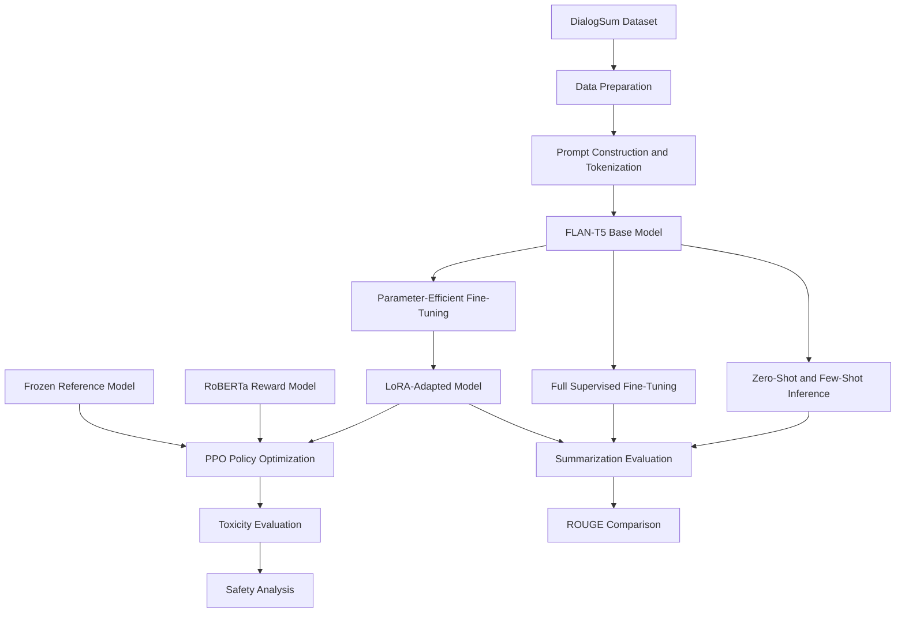

<div align="center">

# Dialogue Summarizer

### Efficient LLM Fine-Tuning, Conversational Intelligence & AI Alignment

An experimental Generative AI pipeline exploring dialogue summarization
through in-context learning, supervised fine-tuning, parameter-efficient
adaptation and reinforcement learning.


**247M+ Base Parameters · 1.41% Trainable with LoRA ·
Prompt Engineering to Reinforcement Learning**

[Overview](#overview) •
[Architecture](#system-architecture) •
[Results](#experimental-results) •
[AI Safety](#ai-safety-and-model-alignment) •
[Getting Started](#getting-started)

</div>

---

## Overview

Human conversations contain repeated information, informal language,
multiple speakers and contextual dependencies that make automated
summarization challenging.

This repository explores how pretrained large language models can
be adapted to generate concise and meaningful dialogue summaries.

Using Google's FLAN-T5 and the DialogSum dataset, the experimental
workflow investigates three fundamental questions:

- How much can prompt engineering improve a pretrained language
  model without changing its parameters?
- Can parameter-efficient fine-tuning achieve comparable
  summarization quality to full model fine-tuning?
- Can reinforcement learning optimize generated summaries
  toward a learned safety objective?

The repository provides a notebook-based experimental environment
for understanding the LLM adaptation lifecycle.

---

## Key Highlights

| Capability | Implementation |
| :--- | :--- |
| Foundation model | Google FLAN-T5 Base |
| Model architecture | Encoder-decoder Transformer |
| Dataset | DialogSum |
| In-context learning | Zero-shot, one-shot and few-shot prompting |
| Supervised fine-tuning | Hugging Face Trainer |
| Efficient fine-tuning | PEFT with LoRA |
| Reinforcement learning | Proximal Policy Optimization |
| Reward model | RoBERTa hate-speech classifier |
| Summarization evaluation | ROUGE-1, ROUGE-2, ROUGE-L, ROUGE-Lsum |
| Safety evaluation | Classifier-based toxicity measurement |
| Experimental environment | Jupyter Notebook / AWS SageMaker |

---

## System Architecture



The pipeline separates prompt-based adaptation, supervised
learning and reward-based optimization, allowing each approach
to be examined independently.

---

## Dataset

The experiments use the DialogSum dataset, available through
Hugging Face.

Dataset:
[knkarthick/dialogsum](https://huggingface.co/datasets/knkarthick/dialogsum)

DialogSum contains more than 10,000 dialogues accompanied by
human-written summaries and conversational topics.

| Field | Description |
| :--- | :--- |
| Dialogue | Multi-turn conversation |
| Summary | Reference human-written summary |
| Topic | Main subject of the conversation |

The dataset supports supervised dialogue summarization and
evaluation against reference summaries.

---

## Phase 1 — Prompt Engineering

Notebook:
[Lab 1](Lab_1_summarize_dialogue.ipynb)

The first experimental stage investigates the effect of input
instructions on the pretrained language model.

### Zero-Shot Learning

The model receives an instruction and a dialogue without
additional demonstrations.

Example prompt:

```text
Summarize the following conversation.

Person A: Can we move tomorrow's meeting to Friday?
Person B: Yes, Friday afternoon works for me.
Person A: Great, I will update the invitation.

Summary:
```

An illustrative expected summary would be:

```text
The speakers agree to reschedule their meeting to Friday afternoon.
```

### One-Shot Learning

A completed dialogue-summary example is provided before the
target conversation.

This helps establish the expected output structure.

### Few-Shot Learning

Multiple dialogue-summary examples are provided as context.

The model learns the intended task through demonstrations
without updating its parameters.

### Generation Configuration

The notebook also explores how generation parameters influence
output length, diversity and consistency.

- Maximum generated tokens
- Sampling
- Temperature
- Top-k sampling
- Top-p sampling

Prompt engineering provides a lightweight adaptation mechanism,
but its effectiveness remains dependent on the underlying
model and available context.

---

## Phase 2 — Supervised Fine-Tuning

Notebook:
[Lab 2](Lab_2_fine_tune_generative_ai_model.ipynb)

The second stage explores adapting FLAN-T5 to the dialogue
summarization task using supervised learning.

### Full Fine-Tuning

Full fine-tuning updates the pretrained model's parameters
using dialogue-summary training pairs.

The original FLAN-T5 model contains approximately
247.58 million parameters.

The optimization objective is based on predicting the
reference summary tokens conditioned on the input dialogue.

$$
\mathcal{L}_{SFT}
=
-\sum_{t=1}^{T}
\log P_{\theta}(y_t \mid x,y_{<t})
$$

Where:

- x represents the input dialogue.
- y represents the reference summary.
- theta represents the model parameters.
- T represents the summary sequence length.

The notebook demonstrates the training workflow using a
short training run and loads a supplied trained checkpoint
for subsequent evaluation.

---

## Parameter-Efficient Fine-Tuning

Updating every parameter of a large language model can be
computationally expensive.

Parameter-Efficient Fine-Tuning (PEFT) addresses this challenge
by adapting a smaller subset of parameters.

This project explores Low-Rank Adaptation (LoRA).

### LoRA

Instead of directly modifying a pretrained weight matrix,
LoRA introduces trainable low-rank matrices.

$$
W = W_0 + \frac{\alpha}{r}BA
$$

Where:

- W0 is the frozen pretrained weight matrix.
- A and B are trainable low-rank matrices.
- r is the adaptation rank.
- alpha controls the scaling factor.

The original model weights remain frozen while the
low-rank adapters are optimized.

### LoRA Configuration

| Hyperparameter | Value |
| :--- | :--- |
| Rank | 32 |
| LoRA alpha | 32 |
| Target modules | Query and value projections |
| Dropout | 0.05 |
| Bias | None |
| Task type | Sequence-to-sequence language modeling |

### Parameter Efficiency

| Model | Trainable Parameters | Trainable Share |
| :--- | ---: | ---: |
| Full FLAN-T5 | 247,577,856 | 100% |
| FLAN-T5 with LoRA | 3,538,944 | 1.41% |
| PPO model with value head | 3,539,713 | 1.41% |
| Frozen PPO reference model | 0 | 0% |

LoRA substantially reduces the number of parameters requiring
optimization while preserving the pretrained foundation model.

The notebook illustrates adapter training and evaluates a
supplied trained PEFT checkpoint.

---

## Experimental Results

The following results are recorded in the second notebook's
evaluation of precomputed summarization outputs.

These are reference notebook results, not independently
reproduced benchmarks for this repository.

### ROUGE Evaluation

| Model | ROUGE-1 | ROUGE-2 | ROUGE-L | ROUGE-Lsum |
| :--- | ---: | ---: | ---: | ---: |
| Original FLAN-T5 | 0.2334 | 0.0760 | 0.2015 | 0.2015 |
| Full Fine-Tuning | **0.4216** | **0.1804** | **0.3384** | **0.3384** |
| PEFT / LoRA | 0.4081 | 0.1633 | 0.3251 | 0.3249 |

### Observations

- Supervised fine-tuning improves all four recorded ROUGE scores
  relative to the original pretrained model.
- LoRA achieves approximately 40.81% ROUGE-1 while updating
  only 1.41% of the adapter-equipped model's parameters.
- Full fine-tuning achieves the strongest recorded ROUGE scores.
- PEFT provides an interesting trade-off between adaptation
  quality and trainable parameter count.

### Understanding ROUGE

| Metric | Evaluation Focus |
| :--- | :--- |
| ROUGE-1 | Unigram overlap |
| ROUGE-2 | Bigram overlap |
| ROUGE-L | Longest common subsequence |
| ROUGE-Lsum | Summary-level longest common subsequence |

ROUGE measures lexical overlap against reference summaries.
It does not independently establish factual correctness,
semantic consistency or overall safety.

---

## Phase 3 — Reinforcement Learning

Notebook:
[Lab 3](Lab_3_fine_tune_model_to_detoxify_summaries.ipynb)

The third experimental stage explores reward-based language
model optimization using Proximal Policy Optimization (PPO).

The objective is to investigate whether generated summaries
can be adapted toward lower measured toxicity.

### Reinforcement Learning Components

| Component | Implementation |
| :--- | :--- |
| Policy model | Summarization-adapted FLAN-T5 |
| Reference model | Frozen policy reference |
| Value network | Sequence-to-sequence value head |
| Reward model | RoBERTa hate-speech classifier |
| Optimization algorithm | PPO |
| Evaluation | Before-and-after toxicity scores |

### Reward Model

The experiment uses:

[facebook/roberta-hate-speech-dynabench-r4-target](https://huggingface.co/facebook/roberta-hate-speech-dynabench-r4-target)

The classifier produces scores for hate and non-hate classes.

The non-hate class logit serves as the reward signal
for the PPO optimization process.

### PPO Objective

PPO constrains the size of policy updates through a clipped
optimization objective.

$$
L^{CLIP}(\theta)
=
\mathbb{E}_t
\left[
\min
\left(
r_t(\theta)\hat{A}_t,
\operatorname{clip}(r_t(\theta),1-\epsilon,1+\epsilon)
\hat{A}_t
\right)
\right]
$$

The objective helps limit excessively large policy changes
during reinforcement learning.

A frozen reference model also provides a baseline for
monitoring divergence from the original policy.

---

## AI Safety and Model Alignment

Optimizing a language model against a reward signal does
not guarantee that the desired real-world behaviour improves.

The third notebook records the following toxicity measurements.

| Metric | Before PPO | After PPO |
| :--- | ---: | ---: |
| Mean toxicity | 0.02863 | 0.03254 |
| Standard deviation | 0.03560 | 0.03795 |
| Relative mean toxicity change | — | +13.66% |

Lower toxicity scores are preferred.

The recorded experiment therefore shows an increase in measured
toxicity rather than a reduction.

### Why This Result Matters

Negative experimental results are important in AI safety.

They demonstrate the need to distinguish an optimization
objective from actual measured behaviour.

Potential explanations worth investigating include:

- Insufficient optimization steps.
- Reward model limitations.
- Small evaluation sample sizes.
- Sensitivity to decoding parameters.
- Policy divergence.
- Reward and evaluation mismatch.
- Random variation between generated summaries.

These are research hypotheses, not established explanations
for the recorded outcome.

A stronger safety evaluation should include independent
classifiers, controlled generation settings, larger evaluation
sets and human review.

---

## Technology Stack

| Category | Technology |
| :--- | :--- |
| Programming | Python |
| Deep Learning | PyTorch |
| Foundation Model | FLAN-T5 |
| NLP Framework | Hugging Face Transformers |
| Efficient Fine-Tuning | PEFT, LoRA |
| Reinforcement Learning | TRL, PPO |
| Dataset Management | Hugging Face Datasets |
| Evaluation | Hugging Face Evaluate, ROUGE |
| Numerical Computing | NumPy |
| Data Analysis | Pandas |
| Experiment Environment | Jupyter Notebook |
| Cloud Environment | AWS SageMaker |

---

## Repository Structure

```text
Dialogue-Summarizer/
│
├── Lab_1_summarize_dialogue.ipynb
│   └── Prompt engineering and in-context learning
│
├── Lab_2_fine_tune_generative_ai_model.ipynb
│   └── Full fine-tuning, LoRA and ROUGE evaluation
│
├── Lab_3_fine_tune_model_to_detoxify_summaries.ipynb
│   └── PPO, reward modeling and toxicity evaluation
│
├── .gitignore
└── README.md
```

---

## Getting Started

### Prerequisites

- Python environment compatible with the notebook dependencies
- Jupyter Notebook or JupyterLab
- Internet access for model and dataset downloads
- GPU recommended for fine-tuning experiments
- Access to required reference checkpoints and evaluation files

### 1. Download the repository

```bash
git clone https://github.com/Raja-bibla/Dialogue-Summarizer.git
cd Dialogue-Summarizer
```

### 2. Create an isolated Python environment

```bash
python3 -m venv .venv
source .venv/bin/activate
```

### 3. Install Jupyter

```bash
python -m pip install jupyter
```

### 4. Launch the notebook environment

```bash
jupyter notebook
```

### 5. Execute the notebooks in order

| Order | Notebook | Objective |
| ---: | :--- | :--- |
| 1 | Lab 1 | Prompt engineering |
| 2 | Lab 2 | Supervised and efficient fine-tuning |
| 3 | Lab 3 | Reward-based optimization and safety evaluation |

Each notebook contains its own dependency installation cells.

The original labs use older versions of PyTorch, Transformers,
PEFT and TRL. An isolated compatible environment is recommended
rather than installing the latest packages indiscriminately.

---

## Reproducibility

The notebooks reference external datasets, trained model
checkpoints and precomputed evaluation files.

Some of these artifacts are not bundled with this repository.

Full reproduction requires:

- Access to the original DialogSum dataset.
- Compatible package versions.
- Required pretrained and fine-tuned checkpoints.
- Original evaluation data files.
- Consistent hardware and generation settings.

The included notebooks demonstrate the experimental methodology,
but a fresh installation is not guaranteed to reproduce every
saved output without the external course artifacts.

---

## Limitations

- The repository is notebook-based rather than a deployed service.
- Full training is not independently reproduced here.
- Some experiments use supplied trained checkpoints.
- Certain evaluations use precomputed outputs.
- ROUGE does not guarantee factual consistency.
- Classifier-based toxicity measurements may contain biases.
- The recorded PPO experiment does not demonstrate detoxification.
- Results may vary across datasets and decoding configurations.

---

## Future Research Directions

- [ ] Reproduce supervised fine-tuning independently.
- [ ] Evaluate multiple LoRA ranks and configurations.
- [ ] Compare LoRA with quantized fine-tuning methods.
- [ ] Measure inference latency and GPU memory consumption.
- [ ] Introduce factual consistency evaluation.
- [ ] Evaluate toxicity using independent classifiers.
- [ ] Investigate the negative PPO optimization result.
- [ ] Compare PPO with Direct Preference Optimization.
- [ ] Add experiment tracking and controlled random seeds.
- [ ] Build a standalone summarization API.
- [ ] Develop an interactive application for dialogue analysis.

---

## References

- [FLAN-T5 Model](https://huggingface.co/google/flan-t5-base)
- [DialogSum Dataset](https://huggingface.co/datasets/knkarthick/dialogsum)
- [LoRA: Low-Rank Adaptation of Large Language Models](https://arxiv.org/abs/2106.09685)
- [Proximal Policy Optimization Algorithms](https://arxiv.org/abs/1707.06347)
- [Hugging Face Transformers](https://github.com/huggingface/transformers)
- [Parameter-Efficient Fine-Tuning](https://github.com/huggingface/peft)
- [Transformer Reinforcement Learning](https://github.com/huggingface/trl)

---

## Acknowledgements and Attribution

This repository contains an imported educational lab-based
implementation exploring generative AI with large language models.

The original lab material, implementation and reference results
belong to their respective authors and course providers.

The notebooks are associated with the educational material
covering FLAN-T5 dialogue summarization, PEFT and reinforcement
learning in an AWS SageMaker environment.

Original source links, copyright notices and applicable
license information must be preserved.

Redistribution is subject to the permissions of the original
copyright holders and relevant course terms.

---

<div align="center">

### From Prompt Engineering to Parameter-Efficient Learning and AI Alignment

**Generative AI · Large Language Models · NLP · AI Safety**

</div>
